# VLC Housing Oracle

[](https://github.com/LeopoldWalther/vlc-housing-oracle/actions/workflows/ci.yml)

An event-driven, serverless lakehouse on AWS for the Valencia housing market. Weekly listing
snapshots arrive through a versioned landing contract. This repository turns them into fourteen
historized Apache Iceberg tables with DuckDB SQL, reads the free-text descriptions with a Claude
model, and will publish Gold features and models on top: fair-price estimation, time on market
and market dynamics.

**[Architecture page](https://leopoldwalther.github.io/vlc-housing-oracle/architecture.html)**:
system map, the flow step by step, every technology and where it runs, the decisions with their
rejected alternatives, and the known limits. Its source is one self-contained file,
[`docs/architecture.html`](docs/architecture.html).

| | |
| --- | --- |
| **Stack** | Python 3.12 · DuckDB · Apache Iceberg (PyIceberg, AWS Glue Data Catalog) · Parquet · Claude API · ECS Fargate · Lambda · SQS · EventBridge · S3 · Terraform |
| **Status** | Silver has run in AWS since 25 October 2026, started by landing commits. The text labeller is built and evaluated, its deployment is the open task. Gold and models are not built yet. |
| **Scale** | About 23,000 listings with details, one market walk a week. An incremental run takes about a minute on 1 vCPU. |
| **Cost** | Under $1 a month of AWS for everything in this repository. Nothing runs between events. |
| **Quality** | 387 tests on synthetic data, written test-first. Eleven features delivered through a plan, a review gate and one commit per task; a twelfth is in its last task. |

## Architecture

```mermaid
flowchart LR
    subgraph PRIV["Private acquisition repository"]
        direction LR
        TICK["EventBridge Scheduler<br/>every 3 h"] --> GATE["Lambda<br/>budget gate"]
        GATE -->|"work and budget left"| COL["Collector<br/>ECS Fargate · Python"]
        COL -->|"write-once"| BRZ[("Raw + Bronze<br/>S3 · HTML, JSON Lines")]
        BRZ -->|"run marker event"| LJOB["Landing job<br/>ECS Fargate · DuckDB"]
    end

    LJOB -->|"4 tables, then a commit"| LND[("Landing v3<br/>S3 · Parquet<br/>schema pinned by SHA-256")]

    subgraph PUB["This repository"]
        direction LR
        QUEUE["EventBridge rule<br/>SQS FIFO · Lambda"] -->|"one run at a time"| SIL["Silver task<br/>ECS Fargate<br/>DuckDB SQL + PyIceberg"]
        SIL -->|"replace days, upsert"| ICE[("Silver<br/>Apache Iceberg<br/>Glue catalog · 14 tables")]
        REF[("Reference<br/>census sections")] -->|"spatial join"| SIL
        ICE -->|"after each run"| LAB["Text labeller<br/>ECS Fargate<br/>Claude API batches"]
        LAB --> ENR[("Enrichment<br/>model answers · Parquet")]
        ENR -->|"join by text hash"| SIL
        ICE -.->|"planned"| GOLD[("Gold<br/>Parquet over HTTP")]
    end

    LND -->|"commit event"| QUEUE
```



The platform is two repositories around one S3 data lake. Acquisition is private and ends at the
landing contract. Everything after the contract is here.

1. **Collect** (private). A schedule ticks every three hours. A small Lambda reads this week's
    run reports and the request budget and starts a collector on Fargate only while search areas
    are open and budget is left. A week starts on Sunday; once it is complete nothing starts until
    the next one. Raw pages and Bronze records are written once per run.
2. **Land** (private). The run marker's S3 event starts a Fargate task in which DuckDB turns the
    run's Bronze into four Parquet tables and, last, an immutable commit.
3. **Queue.** The commit's S3 event puts a message on an SQS FIFO queue. A Lambda with a
    concurrency of one adopts or starts the Silver task, so runs never overlap. The message
    carries no work; a lost or repeated event cannot cause wrong data.
4. **Silver.** The task subtracts its ingest log from the list of commits, validates the pending
    runs against the contract, replaces the day partitions they touch, recomputes the affected
    listings and the inferred labels, and writes the ingest log last. A rerun writes the same
    rows.
5. **Label.** When a Silver task exits with code 0, the labeller sends the redacted sale
    descriptions without an answer to the Claude API as one message batch and stores the answers
    as immutable Parquet. Silver joins them by text hash; it never calls a model.
6. **Gold and consumers.** Planned: plain Parquet that a browser reads over HTTP.

## What Silver holds

Thirteen data tables and the ingest log, all Iceberg, all in the namespace `vlc_housing_silver`
([runbook](docs/silver-rebuild.md)).

| Table | One row per | Holds |
| --- | --- | --- |
| `walk` | area walked by one run | the run report: complete or not, replay or not |
| `observation` | listing and day | the newest sighting of a card that day |
| `listing_detail` | detail record | typed attributes: price, rooms, area, coordinates |
| `listing` | listing | newest detail record, first and last day seen |
| `listing_text` | listing with details | title, features and the redacted description |
| `listing_price` | listing and price period | the price history |
| `listing_event` | inferred event | disappeared and reappeared, as observations |
| `listing_quality` | listing with details | twelve flags for implausible values |
| `listing_property_group` | listing with details | listings that are certainly one property |
| `feature_pattern` | feature wording | every wording and the column that carries it |
| `listing_feature_label` | listing with details | let with tenants, bare ownership, furnishing |
| `listing_location` | listing with details | census section, district and municipality |
| `listing_text_label` | listing with a description | renovation state and auction, read by a model |
| `landing_ingest` | processed landing run | the checkpoint, written last |

Facts and inferred labels stay in separate tables. A flag never filters a row, and a listing that
is no longer seen is recorded as disappeared, never as sold.

## Design decisions

Each has a longer record with the alternatives that were rejected.

- **A landing contract splits the platform.** The schema is a file whose SHA-256 is pinned in
    tests on both sides. A change is a new version beside the old one, so this half can be public
    while acquisition stays private.
- **Inputs are immutable, and pending work is a set difference.** Bronze objects and landing
    commits are written once with S3 conditional writes. Silver processes the commits its ingest
    log does not hold. No watermark, no clock, no separate state store
    ([ADR 0003](docs/adr/0003-immutable-bronze-and-landing-per-run.md)).
- **The data is the trigger.** Every stage is started by the object the stage before it wrote.
    There is no orchestrator, and a daily catch-up repairs a lost event.
- **Iceberg for Silver.** A training dataset can pin a snapshot id, and a bad run is rolled back
    to the snapshot before it ([ADR 0001](docs/adr/0001-silver-on-iceberg.md)).
- **DuckDB on one small Fargate task instead of Spark.** The data is megabytes a week. Every
    rule is a SQL file that also runs on a laptop. Iceberg keeps the tables readable by Spark or
    Athena for the day one node is not enough.
- **Runs are serialized before they start.** A review-stage spike showed that PyIceberg rebases a
    conflicting commit instead of failing, so two overlapping runs would both succeed. A FIFO
    queue with a single consumer prevents the overlap.
- **Reference data is an immutable vintage.** Census sections are converted from a file an
    operator downloads, with a manifest that names source, licence and hash
    ([ADR 0004](docs/adr/0004-reference-data.md)).
- **A model answer is an input, not a transformation.** Answers are stored by text hash and
    label version, so a backfill is reproducible and free. A label version goes live only after it
    passes an evaluation gate ([ADR 0005](docs/adr/0005-model-derived-labels.md)).
- **No NAT gateway, nothing always on.** Tasks run for minutes a day in a public subnet behind a
    security group without ingress.

Not used, on purpose: Spark, an orchestrator such as Step Functions or Airflow, and a prompt or
agent framework. The
[architecture page](https://leopoldwalther.github.io/vlc-housing-oracle/architecture.html#stack)
gives the reasons, and its
[limits section](https://leopoldwalther.github.io/vlc-housing-oracle/architecture.html#limits)
lists what this design does not do yet.

## Where the data comes from

Listings are collected privately from a public online source that this repository does not
name. Acquisition is deliberately kept out of this repository. So are all real data: tests and
examples run on a seeded synthetic landing dataset that reproduces the hard cases (replayed
collection runs, runs across midnight, padding cards, duplicate sightings, one property listed
twice).

Census-section boundaries come from the Spanish national statistics office under CC BY 4.0
(*Elaboración propia con datos extraídos del sitio web del INE: www.ine.es*). The boundary file is
kept out of this repository as well; tests run on invented rectangles.

A leak guard in CI fails the build when a file names something that belongs to the private side.

## How work happens here

Every non-trivial change goes through an **Architect → Reviewer → Implementer** workflow
([`.claude/WORKFLOW.md`](.claude/WORKFLOW.md)), with a coding agent in each role and the author
deciding at every gate:

1. the Architect writes a feature plan with explicit assumptions, evidence, test-first slices and
    a monthly cost estimate (`dev/plans/`);
2. the Reviewer checks every claim against the repository and emits an executable technical plan
    only when it approves (`dev/reviews/`, `dev/plans/technical/`);
3. the Implementer executes it one red-green-refactor task at a time, one commit per task.

`python dev/tools/validate_workflow.py` keeps plans, reviews and the feature registry consistent,
and CI runs it on every change together with the tests, the leak guard, ruff and
`terraform validate`.

## Development

```bash
python -m venv .venv && source .venv/bin/activate
pip install -r requirements.txt -r requirements-dev.txt
python -c "import duckdb; duckdb.sql('INSTALL spatial')"

python -m unittest discover -s tests -t .
ruff check src tests dev && ruff format --check src tests dev
python dev/tools/validate_workflow.py
```

A Silver run on synthetic data needs no cloud account:
`python -m src.silver.rebuild --landing <dir> --catalog <name>`
([runbook](docs/silver-rebuild.md)).

## Repository layout

| Path | Holds |
| --- | --- |
| `contracts/landing/` | the landing contract, one directory per version |
| `src/silver/` | the Silver run and its rules as SQL files |
| `src/enrichment/` | the text labeller and its evaluation command |
| `src/reference/` | the converter for census-section vintages |
| `src/synthetic/` | the seeded generator of synthetic landing and reference data |
| `infra/silver/` | Terraform for the queue, the tasks, roles and alarms |
| `docs/` | architecture page, runbook, decision records, data-quality report |
| `dev/` | feature plans, reviews, technical plans and the workflow tools |

## License

MIT, see [LICENSE](LICENSE).
